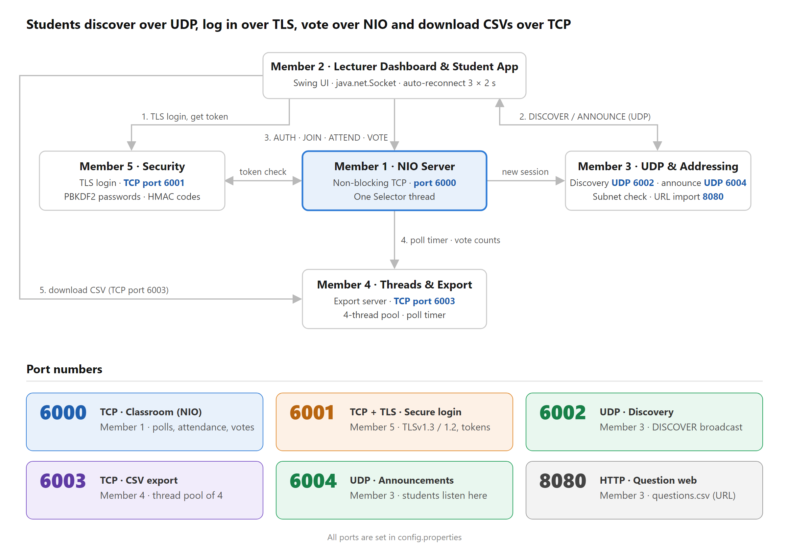

# ClassPulse: classroom live polling and attendance

Java Network Programming, Assignment 02 (group of 5).

A lecturer runs a live session from a laptop. Students on the same Wi-Fi/LAN **discover the session
automatically**, **mark attendance** with a code that changes every 30 seconds, and **answer live polls**.
The results appear as bar charts in real time.

Pure JDK (Java 17+): no Maven, Gradle or external libraries. Everything is compiled with plain `javac`.



---

## 1. Team and responsibilities

Each member owns one networking concept and one folder under `members/`. Each folder holds that member's
source code (`src/`) and a `README.md` with their responsibilities, the lecture theory, the key code
blocks, a 2-minute demo script and likely viva questions.

### Member 1: Java NIO classroom server (TCP 6000), `members/member-1-nio-server`

- **Concept:** non-blocking I/O with `Selector`, `ServerSocketChannel`, `SocketChannel` and `ByteBuffer`.
- **One thread (`NIO-selector`)** serves every lecturer and student connection, even 100 students at once.
- Implements every classroom command (AUTH, CREATE_SESSION, JOIN_SESSION, START_ATTENDANCE, ATTEND,
  CREATE_POLL, IMPORT_POLLS, START_POLL, VOTE, ...), checks the user's role, then calls the other members' code.
- Frames messages by line (`\n`) with a buffer per connection, queues writes with `OP_WRITE`, and limits
  line length (8192 bytes) and the AUTH timeout.
- Shared foundation: `Protocol`, `Config`, `Log`, `NamedThreadFactory`. Also `ServerMain`, which starts all
  4 services, and `LoadTestClient` (the 100-student test).

### Member 2: TCP clients and Swing GUIs, `members/member-2-tcp-clients-gui`

- **Concept:** the TCP socket life cycle with `java.net.Socket`: connect (with a timeout), write, read
  on a reader thread, close, disconnect detection.
- `ClassroomClient`: the client used by both apps. It has synchronized `send()` and **auto-reconnect
  (3 tries, 2 s apart)**, which does a fresh TLS login and re-joins the session.
- `LecturerDashboard`: create a session, large join code, attendance panel with the rotating code, poll
  editor, URL import, live chart, CSV export buttons.
- `StudentApp`: list of discovered sessions, join, attendance box, poll pop-up with countdown, results chart.
- `LoginDialog` (TLS login on a `SwingWorker`) and `BarChartPanel` (a bar chart drawn with Java2D, no library).

### Member 3: UDP, addressing and URL, `members/member-3-udp-addressing-url`

- **Concept:** `DatagramSocket`/`DatagramPacket`, broadcast, `InetAddress`/`InterfaceAddress`, `URL` +
  `HttpURLConnection`.
- `DiscoveryServer` (UDP **6002**) answers DISCOVER probes and broadcasts ANNOUNCE every 3 s to UDP **6004**.
- `SessionScanner` / `DiscoveryClient` / `SessionInfo`: students find sessions without typing an IP.
- `NetworkGuard`:
  - rejects attendance from outside the classroom subnet (prefix-length check);
  - flags one device marking attendance for several students as SUSPICIOUS;
  - runs reverse DNS on a pool thread.
- `QuestionImporter`: imports poll questions from a CSV at a URL. It enforces timeouts, a size limit, the
  response code and content type, and skips bad lines. `QuestionWebServer` serves `sample-questions.csv`
  on HTTP **8080** for the demo.

### Member 4: Multithreading and export server (TCP 6003), `members/member-4-multithreading-export`

- **Concept:** threads, thread pools (`ExecutorService`, `ScheduledExecutorService`), atomic and
  concurrent data, `synchronized`.
- `Poll`: lock-free vote counting (`AtomicIntegerArray`), one vote per student, and a `synchronized`
  `close()` that takes the final snapshot.
- `PollManager`: validates polls and closes each poll exactly on time on the `poll-timer` scheduler.
  It sends throttled live updates every 250 ms.
- `AttendanceBook` / `AttendanceRecord`: one mark per student (`putIfAbsent`); attendance closes automatically.
- `ExportServer` (TCP **6003**, a fixed pool of 4 `export-worker` threads) with `ExportTask` and `CsvBuilder`.
  It sends the attendance and poll CSV files. `ExportClient` downloads them in the background with a
  progress bar, and both CSVs are auto-saved to `exports/` when a session ends.

### Member 5: Secure networking (TLS 6001), `members/member-5-security`

- **Concept:** TLS with `SSLServerSocket`/`SSLSocket`, keystores, password hashing, one-time codes.
- `SecureLoginServer` (TCP **6001**, TLSv1.3/1.2 only) and `SecureLoginClient`. The client uses a
  truststore and **hostname verification**, and its error messages tell a wrong password apart from a
  certificate problem or a server that is down.
- `UserStore`: **PBKDF2WithHmacSHA256** (65536 iterations, 16-byte random salt). `data/users.txt` never
  contains a password.
- `TokenStore`: 32-byte `SecureRandom` tokens with a 4-hour expiry. The NIO server checks them on AUTH.
- `AttendanceCodeGenerator`: TOTP-style HMAC-SHA256 codes that rotate every 30 s (current + previous
  window accepted).
- `scripts/gen-keystore`: creates the RSA key pair, the certificate (optionally with the LAN IP) and the
  client truststore.

### Port numbers

| Port | Protocol | Service | Member |
|---|---|---|---|
| **6000** | TCP (NIO) | Classroom server: sessions, attendance, polls, votes | 1 |
| **6001** | TCP + TLS | Secure login / register, returns a token | 5 |
| **6002** | UDP | Discovery: students send DISCOVER, the server replies | 3 |
| **6003** | TCP | CSV export (thread pool of 4) | 4 |
| **6004** | UDP | Announcements: students listen here | 3 |
| **8080** | HTTP | Question web server (`questions.csv`) for the URL import | 3 |

All ports are set in `config.properties`.

---

## 2. Setup

### 2.1 Requirements

- **JDK 17 or newer.** Check with `java -version`, `javac -version` and `keytool -help`. All three must be on
  the PATH. (Tested with JDK 24.)
- Windows, Linux or macOS. **Run every command from the project folder** (`classpulse/`).

### 2.2 Get the code

```
git clone https://github.com/yasindugunasekara/classpulse.git
cd classpulse
```

### 2.3 Build (once, and after every code change)

| | Windows | Linux / macOS |
|---|---|---|
| Compile everything into `out/` | `scripts\build.bat` | `sh scripts/build.sh` |

You should see `Build OK -> out/`.

### 2.4 Create the TLS keystore (once)

The keystores are **not** in git, because `server.p12` contains the private key. Create them:

| | Windows | Linux / macOS |
|---|---|---|
| Only on one laptop (localhost) | `scripts\gen-keystore.bat` | `sh scripts/gen-keystore.sh` |
| Lecturer laptop used by other laptops | `scripts\gen-keystore.bat 192.168.1.10` | `sh scripts/gen-keystore.sh 192.168.1.10` |

Use the lecturer laptop's real LAN IP in place of `192.168.1.10`. `run-server` creates a localhost keystore
automatically if none exists.

### 2.5 Run everything on one laptop

Open a separate terminal for each step:

1. **Server:** `scripts\run-server.bat` (or `sh scripts/run-server.sh`). The banner shows all ports and the LAN IP.
2. **Lecturer:** `scripts\run-lecturer.bat`. Log in as `lecturer` / `lecturer123` and click **Create session**.
3. **Students:** `scripts\run-student.bat` (open 2–3 of them). The session appears in the list.
   **Login & join** as `s001` / `s001pass`, `s002` / `s002pass`, ...
4. **Attendance:** in the dashboard click **Start attendance**. Students type the large code and click **Mark attendance**.
5. **Polls:** in the dashboard go to **Polls**, create a poll, select it and click **Start poll**. Students
   vote and the chart updates live.
6. **URL import (optional):** run `scripts\run-question-web.bat`, then import
   `http://localhost:8080/questions.csv` in the dashboard.
7. **Export:** on the **Export** tab, download the attendance or poll CSV. Ending the session also saves
   both CSVs in `exports/`.

### 2.6 Run on several laptops (real classroom)

1. On the lecturer laptop, find the LAN IP (`ipconfig` / `ip addr`; the server banner shows it too).
2. Run `gen-keystore <LAN-IP>` there, then start the server.
3. **Copy `certs/client-truststore.p12`** to the `certs/` folder on every student laptop. It holds only
   the public certificate. Each student laptop also needs the project built (`build`).
4. **Firewall.** On the lecturer laptop, open **TCP 6000, 6001, 6003, 8080** and **UDP 6002**. On student
   laptops, open **UDP 6004**. On Windows, allow Java on *Private networks* when asked.
5. Students run `run-student` and the session appears automatically. If UDP is blocked (common on campus
   Wi-Fi), type the lecturer's IP in **Host (manual fallback)**.
6. Every laptop must use the same `config.properties`.

### 2.7 Demo accounts

| User | Password | Role |
|---|---|---|
| `lecturer` | `lecturer123` | LECTURER |
| `s001`, `s002`, `s003` | `s001pass`, `s002pass`, `s003pass` | STUDENT |

The accounts are created on the first server start in `data/users.txt` (PBKDF2 hashes only). Students can
also click **Register**. Delete `data/users.txt` to reset.

---

## 3. Testing

### 3.1 Unit tests (no server needed)

| | Windows | Linux / macOS |
|---|---|---|
| Build + run all unit tests | `scripts\run-tests.bat` | `sh scripts/run-tests.sh` |

| Test class | Member | What it checks |
|---|---|---|
| `SecurityTest` | 5 | TLS login and register, wrong password, duplicate user, no plain passwords in `users.txt`, rotating codes (current + previous window OK, older rejected) |
| `EngineConcurrencyTest` | 4 | Many threads voting at once, one vote per student, vote after close rejected, parallel attendance marks give exactly 1 record |
| `ClientTest` | 2 | Socket connect, AUTH as the first line, then JOIN_SESSION, reader thread, 20 parallel `send()` calls never interleave, server close detected, friendly errors |
| `AddressingUrlTest` | 3 | UDP discovery message parsing, subnet check, same-device SUSPICIOUS rule, reverse DNS on a pool thread, URL import (good file, bad lines, 404, wrong type, ftp://, unknown host) |
| `ExportCsvTest` | 4 | Poll state machine, 200 parallel votes with no lost updates, CSV headers, percentages, escaping of commas and quotes |

### 3.2 End-to-end smoke test (needs the server running)

1. Start `run-server`, and optionally `run-question-web` (for the URL import check).
2. Run `scripts\run-smoketest.bat` (or `sh scripts/run-smoketest.sh`).

It uses real sockets through every service: TLS login, NIO commands, UDP discovery, attendance codes, the
SUSPICIOUS warning, polls with an automatic close after 10 s, URL import, oversized lines, AUTH timeout,
parallel CSV exports and the export permission check. It should end with **`37 passed, 0 failed`**.

### 3.3 Load test: 100 students

1. Start the server.
2. In the dashboard, create a session, start attendance and start a poll.
3. Run `scripts\run-loadtest.bat` (or `sh scripts/run-loadtest.sh [host] [students] [waitSec]`).

Users `load001..load100` are registered automatically. All 100 log in, join, mark attendance and vote. The
server log shows that one `NIO-selector` thread served them all. They all come from one IP, so they are
flagged SUSPICIOUS; that is expected. The load test needs `debug.exposeAttendanceCode=true`.

### 3.4 Latest results

| Check | Result |
|---|---|
| Build (`build.sh` and `build.bat`), also from a clean copy | OK |
| 5 unit test classes | all passed |
| Smoke test | 37 passed, 0 failed |
| Load test | 100/100 logged in, joined, attended and voted; 0 errors |
| Lecturer Dashboard and Student App start | OK |

---

## 4. Configuration (`config.properties`)

| Key | Default | Meaning |
|---|---|---|
| `port.classroom/login/discovery/export` | 6000/6001/6002/6003 | Service ports |
| `port.announce` | 6004 | UDP port students listen on for announcements |
| `port.questionweb` | 8080 | Question web server |
| `tls.verifyHostname` | true | Check the certificate's SAN against the host |
| `attendance.requireSameSubnet` | true | Reject attendance from other networks (loopback is always allowed) |
| `attendance.maxPerDevice` | 1 | More students than this from one IP are marked SUSPICIOUS |
| `attendance.codeWindowSec` | 30 | How often the attendance code changes, in seconds |
| `poll.showResultsAfterVote` | true | Students see live results right after voting |
| `export.demoDelayMs` | 1500 | Artificial delay so parallel exports are visible in the log (0 = off) |
| `debug.exposeAttendanceCode` | true | Writes the current code to `data/current_code.txt` for the load test (**set false for real classes**) |

You can override any key on the command line, for example `java -Dport.questionweb=8090 -cp out ...`.

## 5. Project structure

```
classpulse/
├── README.md, config.properties
├── images/           architecture diagram with port numbers
├── members/
│   ├── member-1-nio-server/          README.md + src/  (common, server, server/nio, tools/LoadTestClient)
│   ├── member-2-tcp-clients-gui/     README.md + src/  (client)
│   ├── member-3-udp-addressing-url/  README.md + src/  (udp, addressing, tools/QuestionWebServer) + sample-questions.csv
│   ├── member-4-multithreading-export/ README.md + src/ (engine, export)
│   └── member-5-security/            README.md + src/  (security)
├── scripts/          build, gen-keystore, run-server, run-lecturer, run-student, run-question-web,
│                     run-tests, run-smoketest, run-loadtest  (.bat for Windows, .sh for Linux/macOS)
├── tests/            SecurityTest, EngineConcurrencyTest, ClientTest, AddressingUrlTest, ExportCsvTest, SmokeTest
├── certs/            generated keystore / truststore (not in git)
├── data/             users.txt (generated), current_code.txt (debug)
└── exports/          CSV files saved when a session ends
```

## 6. Troubleshooting

| Symptom | Cause / fix |
|---|---|
| `javac` / `keytool` not found | Install JDK 17+ and add its `bin` folder to the PATH. |
| `Keystore certs/server.p12 not found` | Run `gen-keystore`. |
| `Certificate problem ... not valid for '<ip>'` | The certificate lacks the LAN IP. Run `gen-keystore <ip>`, restart the server and copy the truststore again. Quick workaround: set `tls.verifyHostname=false` on the clients. |
| `Truststore ... not found` (student laptop) | Copy `certs/client-truststore.p12` from the lecturer laptop. |
| `Cannot reach the login service` / `server is not running` | Wrong host, the server is not started, or the firewall blocks it. |
| No session in the Student App list | UDP is blocked. Use the manual host field, and check that a session was created. |
| `Address already in use` | A previous server is still running, or another program uses the port. Change the port in `config.properties`; for example, 8080 is often taken, so set `port.questionweb=8090`. |
| `attendance is only allowed from the classroom network` | The student is on a different subnet. For mixed networks, set `attendance.requireSameSubnet=false`. |
| Load test says "No active session" | Create a session first, and set `debug.exposeAttendanceCode=true`. |
| GUI shows "Connection ... lost" | The server stopped. The client retries 3 times; after that, click **Reconnect** once the server is back. Sessions live in server memory, so after a restart the lecturer creates a new session. |
